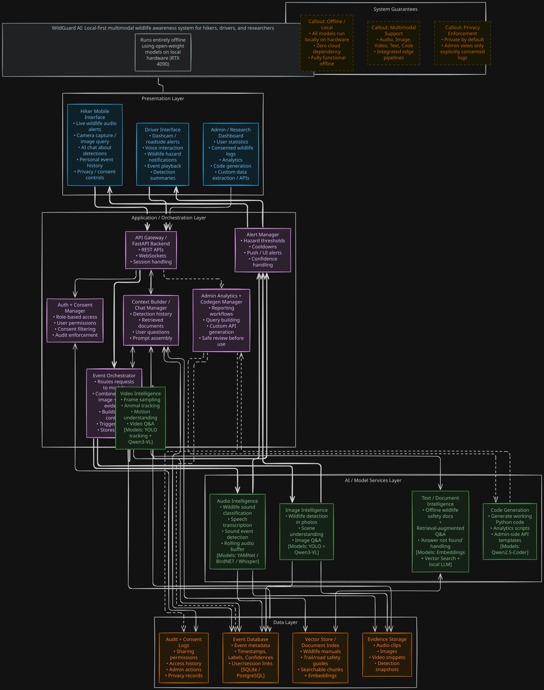

# WildGuard AI

WildGuard AI is a local-first, multimodal wildlife-awareness platform for
drivers, hikers, and researchers. It uses a shared event, alerting, storage, and
privacy foundation while allowing each application to use a detector optimized
for its own safety priorities and operating environment.

The architecture is designed to run entirely offline on local hardware. User
evidence and activity remain private by default, and research or administrative
access is limited to explicitly consented records.

## Product direction

WildGuard will not initially depend on one universal detector performing every
wildlife task equally well. The platform shares infrastructure and contracts,
but detection priorities, model training data, thresholds, and evaluation
criteria are application-specific.

| Application | Detection priority | Optimization focus |
| --- | --- | --- |
| Driver safety | Deer first; then elk and moose | Roads, headlights, darkness, distance, motion blur, and low-latency warnings |
| Hiking safety | Bears, mountain lions, and wolves | Potentially dangerous close encounters and conservative safety alerts |
| Wildlife monitoring | Broad North American species | Existing 26-class YOLO detector and general observation workflows |
| Audio monitoring | Wolves, coyotes, and other identifiable vocalizations | Separate audio event-detection and classification pipeline |

The active MVP is **deer spotting for the driver interface**. The object
detection stage emits the shared bounding-box label `animal`; `deer` is a
downstream species/hazard classification used by the driver alert policy. This
keeps detection compatible with MegaDetector and future elk, moose, and hiking
pipelines without discarding original species labels from training metadata.
The existing 26-class YOLO model remains the broad wildlife baseline and a
source of initial predictions; it is not assumed to be the final driver-safety
model.

See [`docs/product-direction.md`](./docs/product-direction.md) for scope,
success criteria, model boundaries, and the phased roadmap.

## System architecture

The source architecture is maintained in [`design.svg`](./design.svg). Open the
SVG directly for a full-size, zoomable version.



The system is divided into four layers, with three guarantees applying across
all of them:

- **Offline/local:** open-weight models run on local hardware with no required
  cloud dependency.
- **Multimodal:** audio, images, video, documents, and generated code share a
  coordinated event pipeline.
- **Private by default:** administrative views receive only explicitly
  consented records, with access and policy decisions recorded for audit.

### 1. Presentation layer

| Client | Primary responsibilities |
| --- | --- |
| Hiker mobile interface | Later-phase dangerous-wildlife alerts, camera/audio queries, detection history, and privacy controls |
| Driver interface | Active MVP: dashcam deer detection, tracked road-hazard warnings, event playback, and detection summaries |
| Admin/research dashboard | Aggregate statistics, consented wildlife logs, analytics, reviewed code generation, and custom data APIs |

Clients communicate with the backend through REST for request/response work and
WebSockets for live detections and alerts. They do not call models or storage
services directly.

### 2. Application and orchestration layer

| Component | Responsibility |
| --- | --- |
| API gateway / FastAPI backend | REST endpoints, WebSocket connections, request validation, and session handling |
| Auth and consent manager | Role-based access, user permissions, consent filtering, and audit enforcement |
| Event orchestrator | Routes model work, combines multimodal evidence, builds event context, triggers alerts, and persists results |
| Alert manager | Applies hazard thresholds, cooldowns, confidence rules, and delivers UI or push alerts |
| Context builder / chat manager | Combines detection history, retrieved documents, and user questions into grounded prompts |
| Admin analytics and codegen manager | Builds reports and queries, generates API or analysis code, and requires review before use |

The event orchestrator is the center of the runtime. It turns raw input into a
single event containing model results, confidence values, evidence references,
user/session ownership, and alert decisions.

### 3. AI and model-services layer

Each capability is isolated behind a service boundary so models can be loaded,
replaced, or tuned without changing the clients or core policy logic.

| Service | Intended capabilities | Candidate models from the design |
| --- | --- | --- |
| Audio intelligence | Separate wildlife vocalization pipeline and later speech features | AnimalCLAP for animal-sound awareness; Whisper for speech; optional lightweight event gating |
| Image intelligence | Generic animal proposals plus application-specific species/hazard classification | Road-animal detector, MegaDetector, existing 26-class YOLO, Qwen3-VL |
| Video intelligence | Frame inference, tracking, deterministic alerting, and asynchronous scene descriptions | YOLO tracking/ByteTrack and SmolVLM2-2.2B-Instruct |
| Text/document intelligence | Offline safety-document retrieval, grounded Q&A, explicit “answer not found” behavior | Embeddings, vector search, local LLM |
| Code generation | Python analytics, reports, and admin-side API templates | Qwen2.5-Coder |

Model output is advisory until the application layer applies confidence,
authorization, consent, and alerting rules.

Model-service boundaries allow the driver, hiking, monitoring, and audio
pipelines to evolve independently. They should produce the same normalized
detection/event contracts rather than share one mandatory set of weights.

### Local event-description runtime

SmolVLM2 runs in an isolated local service so its dependencies cannot disturb
the YOLO runtime. Start both processes in separate terminals:

```bash
./scripts/run_smolvlm_service.sh
./scripts/run_wildguard_api.sh
```

`POST /events` returns the rule-based decision immediately. Its stable event
contract includes `event_id`, `source`, `timestamp`, `detections`, `decision`,
and `description_status`; description state is one of `pending`, `completed`,
`failed`, or `skipped`. `GET /events/{event_id}` returns any later validated
scene description.

The decision engine is the pure function
`evaluate_risk(event_context, policy_config)`. It consumes only structured
detection evidence and returns an alert level, `should_alert`, and stable reason
codes. SmolVLM output cannot create, suppress, or change that decision.

Description work uses a bounded background queue with one consumer, so only
one SmolVLM request reaches the GPU at a time. Evidence selection is
reproducible: the first valid detection frame, highest-confidence frame, and a
later representative frame are deduplicated by timestamp and returned in
chronological order. A timeout, invalid model JSON, missing frame, full queue,
or unavailable audio model changes only description/audio status; detection
and alert processing continue. The current hackathon slice uses an in-memory
event store; durable persistence and WebSocket delivery remain UI integration
work.

For the single-user demo, the main API also accepts a raw short driving video:

```bash
curl -F "video=@/path/to/drive.mp4" http://127.0.0.1:8000/videos/analyze
```

`POST /videos/analyze` stores the upload under `storage/evidence/`, runs the
local `storage/models/driver_animal_nano/best.pt` YOLO26n checkpoint with
ByteTrack, aggregates tracks into structured evidence, and passes that evidence
to the same decision and description pipeline. The response contains processing
metadata, evidence-image URLs, and the event decision. Local frontend origins
on ports 3000, 5173, and 8000 are allowed by CORS.

### 4. Data layer

| Store | Contents |
| --- | --- |
| Event database | Event metadata, timestamps, labels, confidence values, and user/session links; SQLite locally or PostgreSQL for larger deployments |
| Evidence storage | Audio clips, images, video snippets, and detection snapshots |
| Vector store/document index | Chunked wildlife manuals and trail/road-safety guides with embeddings |
| Audit and consent logs | Sharing permissions, access history, administrative actions, and privacy records |

Event metadata should reference evidence by identifier rather than embedding
large media objects in the relational database. Consent records and audit
events should be append-oriented so access decisions remain traceable.

## Core data flows

### Detection and alerting

1. A hiker or driver client streams or uploads audio, image, or video evidence.
2. The API authenticates the session and passes the request to the event
   orchestrator.
3. The orchestrator invokes the appropriate local model services and combines
   their results into an event context.
4. The alert manager evaluates labels, confidence, hazard thresholds, and
   cooldowns.
5. Event metadata and evidence are stored, an audit entry is written, and any
   approved alert is returned over the live client connection.

For the driver MVP, video is processed frame by frame. Detections are associated
across frames, then a persistence and road-risk policy decides whether to warn.
A single uncertain frame must not trigger a safety alert by itself.

### Grounded wildlife Q&A

1. The chat manager loads the user's relevant detection history.
2. Text intelligence retrieves relevant passages from the local document index.
3. A local language model answers using the event context and retrieved text.
4. If the local sources do not support an answer, the system reports that the
   answer was not found instead of presenting an unsupported claim.

### Research and administration

1. The auth and consent manager filters records before they reach analytics.
2. The dashboard works only with the resulting consented dataset.
3. Generated queries, scripts, or API templates require safe review before
   execution or publication.
4. Reads, exports, permission changes, and administrative actions are audited.

## Repository layout

The repository is scaffolded according to the following structure. It maps the
architecture's component boundaries into implementation areas; placeholder
files keep currently empty directories available in version control.

```text
WildGuard/
├── README.md
├── design.svg
├── apps/
│   ├── hiker-mobile/             # Hiker experience and privacy controls
│   ├── driver-client/            # Driver alerts, voice, and playback
│   └── admin-dashboard/          # Consented research and admin workflows
├── backend/
│   ├── api/                      # FastAPI routes, schemas, and WebSockets
│   ├── auth/                     # Identity, roles, consent, and policy checks
│   ├── orchestration/            # Event routing and context assembly
│   ├── alerts/                   # Threshold, confidence, and cooldown rules
│   ├── chat/                     # Grounded Q&A and prompt construction
│   └── analytics/                # Reports and reviewed codegen workflows
├── model_services/
│   ├── audio/                    # YAMNet/BirdNET/Whisper adapters
│   ├── image/                    # YOLO and vision-language adapters
│   ├── video/                    # Sampling, tracking, and video Q&A
│   ├── documents/                # Embedding, retrieval, and local Q&A
│   └── codegen/                  # Sandboxed code/template generation
├── data/
│   ├── migrations/               # Relational schema changes
│   ├── documents/                # Locally indexed reference material
│   ├── datasets/                 # Local model training/evaluation datasets
│   └── seeds/                    # Development-only reference data
├── storage/
│   ├── events/                   # Local database files in development
│   ├── evidence/                 # Private captured media
│   ├── vectors/                  # Local vector indexes
│   └── audit/                    # Append-oriented audit records
├── shared/
│   ├── contracts/                # Cross-service event and API schemas
│   ├── config/                   # Typed settings and local profiles
│   └── observability/            # Local logs, metrics, and tracing helpers
├── tests/
│   ├── unit/
│   ├── integration/
│   └── end_to_end/
├── scripts/                      # Setup, indexing, and maintenance commands
├── docs/                         # Detailed decisions and operational guides
└── deploy/                       # Local containers and hardware profiles
```

Runtime data under `storage/` should not be committed. Reference documents in
`data/documents/` must have clear licensing and provenance, while generated
indexes can be rebuilt locally from those sources. Large files under
`data/datasets/` are also kept out of version control and require documented
source, licensing, and attribution before use or redistribution.

## Architectural boundaries

- Clients access the system only through the API gateway.
- Authorization and consent checks happen before retrieval, analytics, export,
  or administrative display—not only in the user interface.
- Model services cannot independently publish alerts or expose stored evidence.
- Shared contracts define stable event payloads; model-specific structures stay
  inside their service adapters.
- Code generation is restricted to administrative workflows and its output is
  reviewed and sandboxed before execution.
- The default deployment must remain useful without internet access; optional
  integrations must not become runtime requirements.

## Implementation status

The repository contains the architecture scaffold, local Python environment,
normalized detection and event contracts, working image and audio adapters,
dataset evaluation notebooks, the locally cached wildlife models, and a
derived one-class driver-animal dataset with fine-tuned checkpoints. The local
event API now accepts short video uploads, runs YOLO26n with ByteTrack, applies
deterministic alert policy, selects evidence frames, and enriches events
asynchronously through SmolVLM2. The driver client, persistent event store, and
WebSocket delivery remain to be implemented.

The current driver checkpoint is generated at
`storage/models/driver_animal_v2/best.pt` (runtime artifacts under `storage/`
are not committed). It continues training from the v1 one-class checkpoint on
`driver-animal-v2` for 30 epochs at 960 px. Against the same frozen 193-image
test split and evaluation settings, v2 improved recall from 0.838 to 0.847 and
mAP50–95 from 0.632 to 0.650; precision changed from 0.916 to 0.893. On the 31
reviewed road-video training frames, matches at confidence 0.25 and IoU 0.50
increased from 0 to 23. The previous checkpoint remains available at
`storage/models/driver_animal/best.pt` for rollback.

These still-image and training-frame results do not establish road-video safety;
the next model milestone is independent road/night video evaluation and
alert-policy tuning. See
[`notebooks/deer_driver_v1_finetuning_study.ipynb`](./notebooks/deer_driver_v1_finetuning_study.ipynb)
for the original v1 comparison, learning curves, and prediction gallery.

Historical training artifacts under `storage/models/driver_deer/` and the v1
checkpoint under `storage/models/driver_animal/` are retained locally for
reproducibility. Driver-video evaluation now defaults to `driver_animal_v2/`.
The shared `animal` label is a detection taxonomy, not a claim that the current
checkpoint has broad non-deer training coverage.

An experimental v3 checkpoint at `storage/models/driver_animal_v3/best.pt`
continues transfer learning from v2 with 24 manually reviewed, training-only
Tesla road frames containing no animals. It removes the targeted 4.2-second
false-positive burst while retaining the real Tesla encounter from 6.23 to
7.73 seconds. On the frozen benchmark, validation mAP50–95 changed from 0.698
to 0.699; test mAP50–95 changed from 0.650 to 0.647, with higher precision
(0.926) but lower recall (0.829). Unseen-video spot checks also found new false
alarms on vehicles and road structures, so v3 is an experiment rather than the
runtime default. Its record is
`storage/models/driver_animal_v3/training_summary.json`, and the browser-ready
Tesla comparison is under `storage/evidence/tesla_model_comparison/viewable/`.

A parallel YOLO26n deployment experiment is available at
`storage/models/driver_animal_nano/best.pt`. It has 2.53 million parameters and
a 5.5 MB checkpoint, compared with 9.47 million parameters for YOLO26s. On the
frozen test split, YOLO26n scored 0.660 mAP50–95 versus 0.651 for v2, while its
precision/recall were slightly lower (0.873/0.838 versus 0.901/0.847). Batched
RTX 4090 inference measured 3.34 ms/image versus 4.50 ms/image. It detects the
Tesla deer before impact with no pre-encounter detections, but at confidence
0.10 it is more aggressive on the unseen driving clips. Use confidence 0.25 as
the starting demo threshold and keep v2 available when fewer false alerts are
more important. The executed comparison, plots, event timelines, threshold
study, and decision rationale are in
[`notebooks/yolo26_model_comparison.ipynb`](./notebooks/yolo26_model_comparison.ipynb).

`design.svg` remains the source of truth for high-level component relationships.
The product priorities and delivery order are defined in
[`docs/product-direction.md`](./docs/product-direction.md).

## Development environment

The backend and AI environment uses Python 3.12 and
[`uv`](https://docs.astral.sh/uv/) for dependency management.

```bash
# Create/update .venv and install runtime + development dependencies
uv sync

# Activate the environment (optional; `uv run` works without activation)
source .venv/bin/activate

# Verify the core tools
python -c "import ultralytics; print(ultralytics.__version__)"
pytest
ruff check .
```

Dependency versions are resolved in `uv.lock`; commit both `pyproject.toml` and
`uv.lock` when dependencies change. Model weights and datasets remain local and
are not committed.

### North American wildlife detector

The image service integrates the 26-class
`UWyo/wildlife-north-american-wildlife` YOLO26s model. Weights are downloaded
from Hugging Face into ignored local storage on first use, or explicitly with:

```bash
uv run python -m scripts.download_wildlife_model
```

Run a prediction against a local image:

```bash
uv run python -m scripts.predict_wildlife path/to/image.jpg --save
```

Normalized JSON detections are printed to standard output. Annotated output is
written under `storage/evidence/predictions/` only when `--save` is supplied.
The model is distributed under CC BY 4.0; retain the model author's attribution
when publishing results or derivative work.

This model serves two roles: the broad wildlife-monitoring detector and the
baseline against which the deer-first driver detector is measured. Driver
safety results must be reported separately on road/night conditions; broad
species accuracy is not a substitute for deer hazard performance.

Fine-tune and compare separate one-class driver models without overwriting the
broad detector:

```bash
uv run python -m scripts.train_deer_detector
```

The comparison selects between wildlife-domain and official COCO initialization
using the validation split, then evaluates only the selected checkpoint on the
derived test split. Outputs remain local under `storage/models/driver_animal/`.

Evaluate a balanced sample from the Oregon species-folder dataset with:

```bash
uv run python -m scripts.evaluate_wildlife_folders \
  data/datasets/oregon_wildlife/oregon_wildlife \
  --samples-per-class 25 \
  --output storage/events/oregon-evaluation.json
```

This reports image-level target detection and top-1 rates for the nine mapped
classes. Because the dataset provides folder labels rather than bounding-box
annotations, these figures are not object-detection mAP.

Executed dataset analyses live in:

- `notebooks/wildlife_very_dark_evaluation.ipynb`
- `notebooks/oregon_wildlife_evaluation.ipynb`
- `notebooks/deer_detection_evaluation.ipynb`
- `notebooks/deer_driver_v1_baseline_evaluation.ipynb` — bounding-box AP,
  threshold, source, size, and class-confusion analysis on the derived driver
  dataset

Launch notebooks with:

```bash
uv run jupyter lab
```

For another folder dataset, override the label mapping. For example, the local
deer dataset stores its images in a `train/` folder:

```bash
uv run python -m scripts.evaluate_wildlife_folders \
  "data/datasets/Deer Detection Dataset.v2i.multiclass" \
  --label-map train=mule_deer \
  --samples-per-class 25
```
